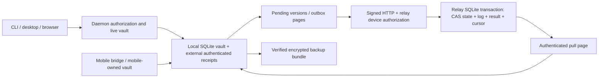

# SentinelPass Strategic Remediation Plan

**Version:** 1.0

**Date:** 2026-09-04

**Status:** Active planning baseline

**Scope:** Core vault, recovery, persistence, sync/relay, daemon IPC, desktop,
browser extension, Android, iOS, testing, release engineering, and product gaps

## 1. Executive Direction

SentinelPass has a strong local-first foundation, but the current sync, recovery,
IPC, and mobile implementations are not yet suitable for production credentials.
The next cycle is a security-architecture program, not a feature-completion sprint.

Work is ordered by this fixed priority:

1. Security and recovery correctness
2. Persistence and synchronization resilience
3. Security-conscious UX
4. Baseline password-manager completeness
5. Sharing, enterprise, and true passkey-provider capabilities

The target product sequence is:

- production-ready local desktop and browser operation,
- recoverable encrypted backups,
- adversarially safe optional sync,
- production mobile clients,
- broader personal and organizational features.

Sync remains opt-in and experimental, and mobile remains prototype-status, until
their phase-specific release gates in this plan are met.

## 2. Strategic Invariants

- The master password is never stored, revealed, or recoverable. Recovery unwraps
  the vault data-encryption key (DEK) with an independent recovery credential and
  establishes a new password slot.
- Every ciphertext is cryptographically bound to its vault, record, purpose,
  version, and epoch with AEAD associated data (AAD).
- The daemon is the only live DEK owner and database writer on desktop.
- Sync is an idempotent, transactional state machine. Delivery retry, duplication,
  reordering, or interruption cannot silently lose an accepted change.
- The relay may observe bounded routing metadata but cannot silently change object
  identity, type, tombstone state, epoch, or authenticated version history.
- Platform biometric prompts are useful only when cryptographically bound to key
  release by the platform keystore.
- Unsupported controls fail closed, and documentation distinguishes Implemented,
  Partial, Experimental, and Planned behavior.
- No design claims protection from an administrator/root compromise, code injection
  into an unlocked process, or revocation of an offline vault snapshot already
  copied by an attacker.

## 3. Target Architecture and Dependency Order

```text
Threat model and security claims
              |
Recovery model and key slots
              |
Authenticated envelope v2 + schema migration
              |
Transactional persistence + backup/restore
              |
Daemon as sole key/database authority
        +-----+-------------------+
        |                         |
Desktop/browser capability IPC   Sync protocol v2 + relay
        |                         |
        +-------------+-----------+
                      |
             Stable mobile ABI
                      |
             Android and iOS clients
                      |
         External audit and 1.0 release
```

Recovery, envelope v2, and epoch semantics are the critical path. Sync, backup,
biometric, and mobile work must consume those decisions rather than define separate
key hierarchies.

## 4. Required Architecture Decisions

The following Proposed ADRs are design gates. Implementation begins only after the
relevant ADR is accepted:

- ADR-003: security baseline, supported threat model, and release gates
- ADR-004: recovery key slots, rotation, and revocation
- ADR-005: authenticated vault envelope v2 and migration
- ADR-006: sync protocol v2, conflict handling, and rollback resistance
- ADR-007: daemon authority and IPC capabilities
- ADR-008: authenticated backup and verified restore
- ADR-009: mobile ABI and platform-keystore boundary
- ADR-010: release signing, provenance, and audit assurance

## 5. Program Phases

### Phase 0: Containment and truthful status

**Target:** 1-2 weeks

**Release:** 0.8.x

Deliverables:

- Keep sync disabled by default and label it experimental.
- Label Android and iOS clients as prototypes, not daily-driver clients.
- Label recovery as unavailable; do not imply that the old password can be reset.
- Deny originless browser-surface IPC by default.
- Permit cleartext relay URLs only for an explicit loopback development profile.
- Correct claims about full-database encryption, memory locking, biometric parity,
  sync rollback protection, payload padding, and mobile completeness.
- Update the requirements, roadmap, technical-debt tracker, security matrix, and
  release checklist together.
- Assign an owner and target release to every P0/P1 item before implementation.

Exit criteria:

- Incomplete security features cannot be enabled accidentally.
- Public documentation matches runtime behavior.
- Every known gap has traceable ownership, acceptance criteria, and evidence fields.

### Phase 1: Recovery, key hierarchy, and authenticated vault format

**Target:** 5-8 weeks

**Release:** 0.9

Deliverables:

1. Add a stable vault UUID, explicit format version, and monotonic crypto epoch.
2. Add a key-slot registry for password, recovery, platform device/biometric, and
   trusted-device slots.
3. Generate a 128-256-bit recovery secret with checksum, printable form, QR form,
   and mandatory setup verification.
4. Bind every wrapped DEK to vault UUID, slot UUID/type, epoch, and crypto version.
5. Replace uncontextualized field encryption with versioned summary and secret
   envelopes whose AAD binds vault, entry, type, purpose, epoch, and format.
6. Replace long-lived `bincode` persistence with a documented, language-neutral,
   bounded serialization format.
7. Add hard maximums for KDF memory, time, parallelism, output size, and all decoded
   allocation lengths. Calibrate desktop and mobile KDF profiles above a common floor.
8. Make password rotation atomic: stage and verify new material, commit it, then
   adopt it in memory.
9. Fail closed on a newer unsupported schema or crypto format.

Migration contract:

1. Unlock and validate the legacy vault.
2. Create a verified pre-migration backup.
3. Build v2 tables beside legacy tables.
4. Generate stable identifiers and the initial password slot.
5. Re-encrypt every record with v2 AAD.
6. Decrypt and verify every migrated envelope and relationship.
7. Atomically activate v2 and retain the user-controlled encrypted backup.
8. Refuse downgrade opening from older clients.

Exit criteria:

- Cross-field, cross-record, cross-vault, and metadata substitution fail
  authentication.
- Recovery opens the vault without the old password and creates a new password slot.
- Failed migration leaves the legacy vault usable.
- Fixtures for every released schema migrate to the current format.
- Recovery, slot deletion, epoch change, and compromise rotation have negative tests.

### Phase 2: Transactional persistence, storage hygiene, audit, and backup

**Target:** 4-6 weeks; may overlap late Phase 1

**Release:** 0.9-0.10

Deliverables:

- Introduce application services and a unit-of-work boundary for credential CRUD,
  remote apply, slot rotation, recovery, backup, and restore.
- Remove multi-table write sequences from UI, sync, and ad hoc vault call sites.
- Replace local-change SQL-trigger side effects with explicit local and remote write
  paths, or otherwise prove that remote writes cannot be re-marked pending.
- Preserve SQL NULL through encryption, serialization, sync, and restore.
- Make registry/index updates transactional rather than best-effort.
- Set explicit application-directory, database, WAL/SHM, token, grants, audit,
  export, and backup permissions and Windows ACLs.
- Validate file owner, type, and symlink behavior before opening sensitive files.
- Replace title/domain audit context with opaque identifiers; add integrity chaining,
  rotation, retention, and verification.
- Zeroize intermediate KDF buffers, FFI buffers, and owned secret transport values.
- Remove unnecessary `Debug` and `Clone` from secret-bearing protocol structures.
- Create an authenticated portable backup containing the encrypted snapshot, key
  slots, format manifest, vault identity, epoch, and integrity metadata.
- Use SQLite snapshot/backup APIs rather than copying a live DB/WAL file set.
- Add atomic restore, validation, dry-run reporting, and recovery drills.

Exit criteria:

- Fault injection at each persistence step cannot corrupt the active vault.
- Restores from every supported format pass integrity and functional verification.
- No plaintext secret appears in normal logs, audit context, or crash diagnostics.
- All security-sensitive files receive explicit permissions and owner checks.

### Phase 3: Daemon ownership and capability-based IPC

**Target:** 4-6 weeks

**Release:** 0.10

Deliverables:

- Make the daemon the sole desktop DEK owner and database writer.
- Route CLI and desktop CRUD through application-service IPC.
- Reserve offline maintenance mode for an exclusive, explicitly stopped daemon.
- Replace self-asserted origin authorization with audience- and operation-scoped
  capabilities.
- Give the native host a distinct installation capability unavailable to ordinary
  CLI/external-tool clients.
- Retain least-privilege client/domain/field/write grants for external tools.
- Validate Unix peer UID where supported and apply owner-only socket permissions.
- Apply an explicit current-user SID ACL and remote-client rejection to Windows pipes.
- Derive directional session keys with HKDF; bind protocol version, direction,
  message type, session, and counter as AAD.
- Add connection/read/write/idle/operation deadlines, bounded concurrency, and replay
  counters.
- Run Argon2 and other blocking work in a bounded blocking pool.
- Replace poisoned-lock `unwrap()` paths with controlled errors and safe lock state.

Exit criteria:

- A client possessing only the general daemon token cannot claim native-host access.
- Stalled clients do not block unrelated clients.
- Replay, reflection, wrong-direction, malformed, and oversized frames are rejected.
- One daemon process owns all unlocked desktop key and database state.

### Phase 4: Sync protocol v2 and relay hardening

**Target:** 6-10 weeks

**Release:** 0.11 beta

Deliverables:

- Treat sync v1 as incompatible and re-bootstrap from an authoritative local v2 vault.
- Define a v2 mutation with vault UUID/epoch, entry UUID/type, expected and resulting
  versions, origin device, mutation idempotency key, tombstone, encrypted payload,
  authenticated metadata, and optional origin signature.
- Separate device request sequence, per-entry version, and server pagination cursor
  into distinct types and persistence fields.
- Return per-entry acceptance/rejection/current-version results.
- Remove an outbox item only after its specific acknowledgement.
- Make server mutation, entry, device sequence, and acknowledgement one transaction.
- Make client page apply, mappings, indexes, inbox record, and cursor one transaction.
- Support duplicate request replay by returning the original result.
- Use normal pagination for full sync; enforce limits consistently at client and relay.
- Preserve conflicting secret versions rather than silently resolving solely by time.
- Authenticate tombstones and define deletion retention/garbage collection.
- Include crypto epoch in every request/object and reject revoked devices/stale epochs.
- Add per-entry version/hash lineage and retain a trusted local high-water mark.
- Replace six-digit encryption with a high-entropy QR bootstrap secret or reviewed
  PAKE; retain a short code only as a human comparison value.
- Put pairing material in request bodies, make it one-use and short-lived, and bind
  registration to the pairing transcript.
- Require HTTPS except explicit loopback development, restrict redirects, and reject
  userinfo in relay URLs.
- Trust forwarded IP addresses only from configured proxies.
- Enforce bounded per-vault/device quotas, blob sizes, entry counts, pairing counts,
  and rate-limit state.
- Remove blocking single-connection database access from async relay handlers.
- Publish a supported self-host profile for TLS, proxying, data backup, logs, metrics,
  retention, and disaster recovery.

Exit criteria:

- Model/chaos tests converge under loss, duplication, reordering, retries, concurrent
  edits, stale devices, and crashes.
- No local item is marked synced without a per-object acknowledgement.
- A malicious relay cannot undetectably change identity, type, tombstone, epoch, or
  authenticated version lineage.
- Recovery and compromise workflows revoke prior online sync authority.

### Phase 5: Desktop and browser hardening

**Target:** 4-6 weeks

**Release:** 0.10-0.11

Desktop deliverables:

- Store summaries in UI state and use short-lived reveal/copy handles for secrets.
  *(Amended 2026-09-04 by ADR-005 rev 4 acceptance: the summary index is daemon-owned,
  lazy, and zeroized on lock; the desktop UI re-requests summaries rather than
  caching its own copy.)*
- Scrub DOM fields, JavaScript state, TOTP state, and timers on lock.
- Lock on configured inactivity, background, OS session lock, suspend, and logout.
- Install a privacy cover before the app loses visibility.
- Require configurable reauthentication for reveal, export, recovery, and private keys.
- Parse URLs structurally and refuse or warn on HTTP.
- Minimize Tauri capabilities and CSP; remove unused shell/clipboard permissions.
- Remove production debug-unlock artifacts.
- Use native sensitive clipboard behavior with expiry where available.
- Replace Windows consent-plus-generic-keyring retrieval with key release bound to
  Windows Hello or an approved Windows cryptographic protection API.

Browser deliverables:

- Default-deny HTTP autofill with an explicit per-site override only if retained.
- Use optional/requested site access where feasible instead of unconditional broad
  host permissions.
- Carry a stable field/form descriptor through autofill requests and responses.
- Respect `autocomplete` semantics and never choose the first password field blindly.
- Require a chooser for ambiguous or password-change forms.
- Define explicit top-level and iframe policy.
- Eliminate or minimize plaintext credential data in extension session storage.
- Generate Chrome and Firefox bundles from shared source.
- Validate browser/native-host identifiers and manifest parity in CI.

Exit criteria:

- Lock reliably removes secrets from visible UI and ordinary state snapshots.
- Browser tests cover login, password change, iframe, HTTP, hostile sender, locked
  daemon, save/update, and Chrome/Firefox parity.
- Desktop and extension consume only daemon capability APIs.

### Phase 6: Android and iOS production readiness

**Target:** 10-16 weeks with parallel platform work

**Release:** 0.12 beta

Shared bridge deliverables:

- Define one generated C ABI and one JNI package/class contract.
- Add ABI version and feature negotiation.
- Compile every platform feature in CI, including JNI.
- Define typed ownership for handles and returned buffers; zeroize on free.
- Catch panics at FFI boundaries and test repeated create/lock/destroy cycles.
- Replace delete-then-add edits with atomic updates.
- Remove placeholder biometric and sync operations.
- Implement sync v2 through the shared Rust engine.

Android deliverables:

- Fix JNI name/signature/type mismatches and build every supported ABI.
- Use Android Keystore authentication-bound keys for the platform slot.
- Implement AutofillService retrieval and save flows.
- Lock and cover on background, screen lock, reboot, and configured inactivity.
- Deny cleartext network traffic through network security configuration.
- Use `noBackupFilesDir` or a tested encrypted backup allowlist covering WAL/SHM and
  device transfer.
- Remove camera/network permissions until their features exist.
- Add instrumentation tests for JNI, keystore invalidation, process death, lifecycle,
  backup/restore, migration, and autofill.

iOS deliverables:

- Use Keychain `SecAccessControl` for the platform slot and enrollment-change policy.
- Apply explicit complete file protection and backup policy.
- Lock and cover content on scene transitions.
- Use local-only/expiring pasteboard options.
- Implement a Credential Provider extension.
- Remove unused plaintext credential persistence models.
- Consolidate duplicate Swift bridges.
- Implement encrypted backup/export; gate and clearly label plaintext export.
- Add XCTest coverage for restart, enrollment changes, backgrounding, clipboard,
  Credential Provider, migration, and restore.

Exit criteria:

- No placeholder native operation is reachable in a release build.
- Real device/simulator tests cover unlock, CRUD/update, lock, process death,
  biometric invalidation, sync, and autofill.
- Backup behavior is documented and verified.
- Applicable OWASP MASVS controls are reviewed with evidence.

### Phase 7: Release assurance and independent review

**Target:** 4-6 weeks after feature freeze

**Release:** 1.0 release candidate

Deliverables:

- Make security workflows direct prerequisites of tag releases.
- Test all security-relevant Cargo feature combinations and mobile targets.
- Run dependency, secret, license, container, and artifact scanning.
- Add fuzz targets for envelopes, migrations, IPC, sync, imports, and FFI.
- Add property tests for vault operations and sync convergence.
- Produce signed SBOM and provenance attestations.
- Sign Windows binaries/installers and sign/notarize macOS applications.
- Sign updater metadata and verify it before installation.
- Give every dependency-security exception an owner, exposure analysis, mitigation,
  and expiry.
- Commission an independent assessment of crypto use, recovery, sync, IPC, desktop,
  browser, Android, and iOS.
- Resolve all critical/high findings before 1.0.

Exit criteria:

- Zero unresolved critical/high trust-boundary findings.
- Recovery and restore drills pass on every supported platform.
- Sync model/chaos suites pass.
- Release signatures, provenance, notarization, and updater verification pass.
- Security documentation matches code and automated evidence.

## 6. Data and API Design Rules

- Use stable UUIDs for vaults, entries, devices, slots, and mutations.
- Separate display summaries from secret payloads, but authenticate both contexts.
- Store domain originals encrypted and use keyed equality tags for lookup.
- Use explicit nullable types end to end; never encode absence as an empty ciphertext.
- Validate timestamps and reject corrupt values instead of substituting current time.
- Put algorithm, schema, and payload versions inside every durable envelope.
- Apply maximum encoded/decoded sizes before allocation.
- Return the least secret data necessary for an operation.
- Use scoped reveal/copy/fill capabilities instead of returning a complete entry.
- Keep protocol, backup, and FFI schemas language-neutral and versioned.

## 7. UX Work After the Security Foundation

Onboarding must:

- explain that the old master password cannot be recovered,
- create and verify the recovery key,
- explain backup and device-revocation limits,
- calibrate the KDF above a security floor,
- require password and recovery slots before enabling biometric unlock.

Daily UX must provide:

- consistent locked/unlocked state across daemon, desktop, browser, and mobile,
- understandable reauthentication reasons,
- HTTP and ambiguous-form warnings,
- actionable offline/retry/conflict/revoked-device states,
- safe reveal/copy actions without persistent secret state.

Add a Security Center showing recovery verification, backup age and restore status,
KDF health, devices, epoch, sync/conflicts, biometric slots, password health, security
events, and recent exports/recovery actions.

## 8. Feature Expansion After Foundation Work

Baseline completion:

- encrypted backup/import/export,
- KeePass and Bitwarden imports,
- native Android/iOS autofill,
- credential history and trash,
- custom fields and secure notes,
- device/session management,
- password rotation and recovery UI on all clients.

Later personal features:

- identities, payment cards, attachments, tags, and collections,
- privacy-preserving breach monitoring,
- emergency/social recovery,
- secure item sharing.

Defer until separately designed:

- organization sharing, RBAC, and administrative recovery,
- enterprise policy/SSO/SCIM,
- custody and synchronization of passkey private keys.

`passkey_reference` remains metadata only until an authenticator/credential-provider
architecture is accepted and independently reviewed.

## 9. Verification Matrix

| Boundary | Required evidence |
|----------|-------------------|
| Vault crypto | Golden vectors, AAD substitution negatives, fuzzing, migration fixtures |
| Recovery | Lost-password, lost-device, revoked-slot, compromise-rotation drills |
| Persistence | Transaction fault injection, corruption tests, verified restore |
| IPC | Peer/capability negatives, ACL tests, replay/deadline/concurrency tests |
| Sync | Model-based convergence plus loss/duplicate/reorder/crash chaos tests |
| Browser | Chromium and Firefox E2E across hostile and ambiguous forms |
| Android | JNI feature build, instrumentation, keystore, autofill, lifecycle, restore |
| iOS | XCTest, Keychain invalidation, Credential Provider, lifecycle, restore |
| Release | Signed artifacts, SBOM, provenance, updater verification, clean audit gate |

## 10. Governance and Traceability

Every work item must carry:

- requirement ID and priority,
- threat or user need,
- owner and target release,
- governing ADR,
- implementation and test evidence,
- migration and compatibility impact,
- documentation impact,
- status and accepted residual risk.

No security item is `Implemented` merely because code exists. It also needs relevant
positive/negative tests and operational/documentation evidence.

## 11. Resourcing and Release Train

With three senior engineers (core/security, desktop/browser, mobile), fractional
product design, and an external review, a credible 1.0 is approximately 7-10 months.
A single engineer should plan approximately 12-18 months and ship the local desktop
foundation before sync or mobile.

| Release | Intended scope |
|---------|----------------|
| 0.8.x | Containment, truthful status, safer defaults |
| 0.9 | Key slots, recovery, envelope/schema v2, migration |
| 0.10 | Transactions, backup, daemon ownership, IPC, desktop/browser hardening |
| 0.11 | Sync protocol v2 beta and relay operations |
| 0.12 | Android/iOS beta and native autofill *(native desktop autofill later retired — docs/NATIVE_AUTOFILL_RETIREMENT_2026-10-05.md)* |
| 1.0 RC | Feature freeze, independent audit, signing, recovery/restore drills |
| 1.0 | Release only after all security gates close |

October 5 clarification: native desktop autofill was a roadmap intention, not
delivered functionality. Its direct-vault prototype is now retired; future work
must satisfy [native autofill authorization and destination-binding gates](NATIVE_AUTOFILL_RETIREMENT_2026-10-05.md).
The Tauri UI, explicit Copy actions and browser extension are separate paths.

## 12. Definition of Done for 1.0

- Recovery is independent of the old password and verified during onboarding.
- Local and sync ciphertext semantics are authenticated.
- Database migration, backup, restore, and crash recovery are proven across supported
  versions and platforms.
- The daemon is the sole desktop key/database authority with capability IPC.
- Sync is transactional, idempotent, revocable, rollback-resistant, and opt-in.
- Desktop, browser, Android, and iOS pass their platform security gates.
- Release artifacts and updater metadata are signed and independently verifiable.
- No critical/high independent-audit finding remains unresolved.
- Public documentation and the security status matrix match shipped behavior.

## 13. Data assessment and foundational remediation (2026-10-14)

Scope: the 0.17 workspace at `84c7f58`, followed by the foundational changes on
`fix/sync-contract-and-durability`. This is a diagnostic review, not production
certification. **Readiness remains unverified; sync remains experimental.**
No production deployment, migration, write test, or load test was performed.

Evidence labels: **Observed** = inspected source/configuration; **Measured** =
executed local check; **Inferred** = reasoning from those facts; **Unknown** =
missing evidence. Test data is synthetic; test timings are not service benchmarks.

### Requirements, authority and data flow

**Observed:** local credential/SSH/TOTP storage, browser autofill through the
daemon, CLI/desktop operations, encrypted backup/restore, and optional device
sync. Rust and bundled SQLite are the relevant implementation constraints; no
language or database replacement is justified by the evidence.

**Unknown:** user counts, actual vault and tenant size distributions, growth,
request/read/write mix, concurrent devices, latency/freshness SLOs, availability,
RPO/RTO, production topology, retention/deletion obligations, budget and named
operational owners. Repository defaults are not workload evidence.



The mobile arrow describes the same storage role on a mobile device, not access
to the desktop's live database. Desktop compatibility paths also exist; the
daemon and maintenance lock define supported desktop ownership boundaries.

| State / owner role | Grain and keys | Authority and commit/recovery boundary |
|---|---|---|
| Local durable vault / vault owner | Local integer entry/key/TOTP IDs; stable sync UUIDs; vault UUID and key epoch | Encrypted local contents plus authenticated receipt state. `ContentTransaction` publishes pending receipts before SQLite commit, then finalizes; failure after SQL commit can be an uncertain outcome. Recover only a complete old/new snapshot. |
| Local relationships / core maintainer | Entry-to-domain mappings and keyed domain tags; one TOTP parent relationship; entity membership constraints | Domain tags/equality indexes are derived lookup aids, not credential authority. NULL optional values, deletion flags and mapping ownership participate in integrity checks. |
| Process/request state / daemon maintainer | Unlocked keys, manager/DB locks; request-local capability and receipt evidence | Keys disappear on lock/process exit. New `VerifiedRead` owns its SQLite transaction and evidence for one list request. No authorization/receipt TTL cache was added. |
| Durable outbox / sync maintainer | One current pending version and acknowledged version per object | Network sends occur outside the local DB lock. Conditional acknowledgment SQL preserves later edits, deletion flags and unresolved conflicts. Local deduplication alone does not prove exactly-once effects. |
| Relay / relay operator | Current object `(vault_id, object_id)`; log `(vault_id, server_sequence)`; result `(mutation_id, device_id, vault_id)` bound to object | Opaque encrypted payloads and auth/routing metadata only. CAS state, appended mutation, result, epoch and sequence commit in one SQLite transaction. Retries replay stored results; after result expiry CAS prevents an old mutation applying again. |
| Pull / receiving vault owner | Ordered vault-log page; durable cursor; per-object conflict alternative; bounded dead-letter records | Verify metadata and eligibility before application. Apply/disposition and cursor commit together. Dead-letter overflow fails closed; reconciliation is an explicit operational responsibility. |
| Backup / vault owner and release maintainer | Encrypted snapshot plus authenticated manifest | Staged verification and restore tests exist. Backup scheduling, off-host copies, retention and deployed restore objectives remain Unknown. |

**Observed model:** normalized transactional entities and relationships, with
encrypted fields and derived lookup tags. Local integer keys and distributed
UUID identity have different purposes. Relay mutation history is protocol
history, not a business-time warehouse or a guarantee of historical analytics.
Client timestamps do not replace CAS versions or server ordering. Adding stars,
snowflake schemas, SCD/Data Vault structures, CDC infrastructure, a lake, or a
search/vector service would not resolve the demonstrated failures. AI/ranked
semantic search is outside this review's paths; ordinary domain lookup remains
subject to authorization and integrity checks.

**Observed physical design:** embedded row-oriented SQLite, file-backed WAL on
local vaults and relay, foreign keys, primary/unique keys, pending-state indexes,
and ordered vault-log keys. WAL durability, in-memory caches, process deployment,
and replication are separate properties. Device sync is application replication;
it is not SQLite sharding. LSM memtables/SSTables, Bloom-filter tuning and LSM
compaction do not apply to this engine. Existing SQLite access and bounded
application maps suffice for this slice. Full integrity snapshots and some
per-object/domain SQL queries remain material costs.

### Rubric

Scores use the requested 0–4 scale. No dimension is 4: an agreed production
workload and operational validation are absent. Confidence concerns the evidence
shown, not a certification of the whole product.

| Dimension | Weight | Before → after | Evidence location (relative to repository root) | Confidence / gaps |
|---|---:|---|---|---|
| A. Requirements and ownership | 8 | U → U | `README.md`, this requirements inventory | Low; deployment/workload/SLOs/named owners Unknown |
| B. Model, keys, history | 12 | 3 → 3 | `sentinelpass-core/src/database/{schema,migrations,fixtures}.rs`; relay `storage/mod.rs` | Medium; tested constraints/migrations; business retention history Unknown |
| C. Engine fit / placement | 8 | 3 → 3 | Workspace `Cargo.toml`, `Cargo.lock`; core `database/schema.rs`; relay `storage/mod.rs` | Medium; local embedded OLTP fits observed roles; shared-relay capacity unmeasured |
| D. Queries / physical plans | 10 | 2 → 2 | Core `database/repository.rs`, `sync/{change_tracker,outbox}.rs`; relay `handlers/sync_v2.rs` | Medium; bounded scans, offset correction; N+1/snapshot costs and representative plans remain |
| E. Algorithms / bounds | 8 | 1 → 2 | Core `sync/{outbox,client}.rs`, `vault/content_guard.rs`; relay `rate_limit.rs`, `app_state.rs` | Medium; row/wire/key/job bounds tested across relay handlers; not a global memory bound; full snapshots and device populations remain |
| F. Pipeline contracts / quality | 10 | 0 → 2 | `sentinelpass-relay/tests/sync_wire.rs`; core `sync/engine.rs` | High for wire defect/fix; Medium overall; real wire tests plus model tests, operational reconciliation/backfill unvalidated |
| G. Transactions / replay | 10 | 0 → 3 | Core `sync/outbox.rs`; relay `handlers/sync_v2.rs`; both `fault_injection.rs` | High for local invariants; crash/network/retry tests are bounded evidence, not all-environment exactly-once proof |
| H. Security / lifecycle | 10 | 2 → 2 | `SECURITY_ARCHITECTURE.md`; core `vault/content_guard.rs`, `daemon/ipc`; relay `auth.rs` | Medium; auth/tamper regression evidence; cross-platform guarantees, deletion retention and joint artifact rollback remain |
| I. Maintenance / amplification | 6 | 1 → 2 | Lockfile, core `database/schema.rs`; relay `cleanup.rs` | Medium; patched engine/checkpoint progress; indexed maintenance batches tested; v2 history growth and workload qualification remain |
| J. Recovery / observability | 8 | 2 → 2 | Core `vault/backup_ops.rs`; `.github/workflows/drills.yml`; checkpoint tracing | Medium; local restore/fault coverage; deployment RPO/RTO, alerts and restore rehearsal Unknown |
| K. AI/search evaluation | 5 | N/A → N/A | Inspected credential/domain lookup and sync paths | High; no AI, embeddings or ranked retrieval in these paths |
| L. Simplicity / maintainability | 5 | 3 → 3 | Focused commits, existing SQLite/HTTP architecture, regression tests | Medium; no new service; platform qualification and retained-history design still needed |

Scored weight = 87; applicable weight = 95 (includes A=U, excludes K=N/A).
Before: weighted points 36.25, **assessed score 41.7/100**.
After: weighted points 52.25, **assessed score 60.1/100**.
Both have **evidence coverage 91.6%**: `100 × 87 / 95`.
Scores are `100 × weighted points / 87`; Unknowns are not passes or zeros.

No confirmed critical authorization/integrity/data-loss defect was established
in this bounded review. Required production guarantees remain unverified and
therefore block a positive readiness recommendation regardless of this average.
The engine upgrade addresses a documented SQLite WAL-reset defect; actual
exposure of a deployed SentinelPass process was not demonstrated. See SQLite's
[WAL-reset explanation](https://www.sqlite.org/wal.html#walreset) and
[patched release notes](https://www.sqlite.org/releaselog/3_51_3.html).

### Prioritized findings, decisions and tradeoffs

| Priority / severity / effort | Failure evidence and current → implemented behavior | Invariant, alternatives and costs |
|---|---|---|
| 1 / High / Medium | **Measured:** actual client/relay serde models disagreed on `object_type` versus `entry_type`, preventing push/pull. Canonical wire field plus read alias and real HTTP tests replace incompatible contracts. | MAC input unchanged; duplicate field spellings rejected. A: minimal serde correction selected. B: SQL cannot fix a wire contract. C: keep existing behavior fails round trip. No new service or migration. |
| 2 / High / Medium | **Measured:** a delayed v1 ack changed local `(version=2, ack=0, pending)` to `(2,1,synced)`. Conditional SQL now preserves pending edits/deletes/conflicts and monotonic ack/cursors. Relay rejected CAS no longer advances epoch; reused IDs cannot relabel another object. | A: application read/modify/write would race across writers. B: transactional predicates selected; bounded ack HashMap replaces repeated linear matching. C: existing behavior can suppress unsent work. O(page) map memory and indexed updates; conflicting results fail closed. Ciphertext equality is not required because retries re-encrypt with fresh randomness. |
| 3 / High, exposure conditional / Medium | **Observed:** bundled SQLite 3.44.0 predates the WAL-reset fix. Upgrade to rusqlite 0.40.2 / SQLite 3.53.2. **Measured:** the old checkpoint `.execute()` reported `ExecuteReturnedResults`; now query and log actual progress. | Preserve FULL durability and authorizer fault coverage. A: reducing connection overlap cannot substitute for a patched engine. B: qualified bundled upgrade selected. C: staying on the affected version retains the known risk. Dependency/platform qualification cost; no schema change. Checkpoint is not backup or history compaction. |
| 4 / High / Medium | **Measured baseline probe:** 500 tiny mutations encoded to 204,035 bytes against a 65,536-byte default body cap. Collect bounded row pages, batch exact encoded bytes, cap chunked responses, and bound pull pages. | A: bounded client pages selected; B: SQL keyset windows keep extraction near data; C: count-only batches fail under size skew. 128 row payloads plus receipt snapshot remain material memory; a single object is explicitly refused if oversized. Serialization adds CPU; no throughput claim. |
| 5 / High for shared relay / Complex overall | **Observed:** v2 ignored configured object quota, rate maps never evicted, SQLite ran inline on the async executor. Enforce retained-identity quota; bound/expire rate maps; move auth/v2 and cleanup work to blocking workers. | A: bounded maps/work admission selected. B: quota count and writes share a SQL transaction; database pooling/sharding is premature without measurements. C: existing behavior has unbounded keys and ignored quota. O(K) expiry scans at most once/minute; 16 queued/running database-handler jobs; at saturation deny new work. Tombstones consume identity quota. History bytes and production capacity remain open work. |
| 6 / Medium / Medium | **Observed:** listing authenticated the full snapshot then reloaded/re-MACed the whole receipt document per row. One transaction-bound `VerifiedRead` now validates rows against request-local evidence. Offset without LIMIT is corrected; equal titles use entry ID as a tie breaker. | A: request-local reuse selected. B: SQL still supplies the stable snapshot; sorting encrypted titles in SQL would not preserve logical order. C: keeping repeated reads adds avoidable work. **Inferred:** receipt parsing changes from once-per-row to once-per-request; retained receipt-map memory is O(vault size). Latency benefit is unmeasured. No cross-request cache or weakened revocation checks. |
| 7 / High readiness gate / Complex | **Observed:** local backup/fault tests exist, while actual retention/RPO/RTO and maintenance-active capacity are Unknown. Correct stale documentation and checkpoint diagnostics; retain explicit operational gates below. | A: local probes/metrics first. B: durable snapshots and cursor protocol required before log deletion. C: indefinite retention preserves replay but disk growth is unbounded. Additional queue/cache/warehouse components have no demonstrated justification. |

### Verification and remaining acceptance gates

**Measured local evidence:** `cargo test --workspace` passed 1,130 tests, with
4 existing ignored tests (not counted as passed). The sync-enabled suite includes
real HTTP serialization/auth/retry/pull tests, chunked oversized success/error
replies, delayed edit/delete/conflict acknowledgments, integer extremes,
transactional quota rollback, key-map saturation/expiry, CAS/epoch behavior,
bounded scan progress, migration fixtures, authorizer canary/fault sweeps, backup
restore fixtures, pinned-reader checkpoints and request-local receipt concurrency.
`cargo +1.89.0 check -p sentinelpass-core --features sync --locked` also passed.
Workspace Clippy (`--all-targets -- -D warnings`), formatting, and the final
affected suites (137 sync tests; 82 relay tests plus 2 real HTTP tests) passed.
The whole-product latency, peak memory and recovery-time benefits are **Unknown**.

Acceptance for this implementation slice: canonical real-client round trip;
no newer pending mutation cleared by an old ack; no epoch/cursor advance from a
rejected operation; fault sweeps yield complete old/new state; every encoded push
fits 65,536 bytes, every pull fits 4 MiB, oversized input never silently advances
its cursor; retained-identity quota and rate-map/job bounds hold; later requests
recheck receipt integrity. Existing four ignored tests remain visible gaps.

Remaining work in foundational order (roles proposed; named owners Unknown):

1. **Core/security and release maintainers:** qualify Windows/macOS/mobile builds,
   platform file custody, and restored bundles with the patched engine. Run
   independent concurrent writer/checkpoint/restore crash tests on supported
   filesystems. Threshold: no partial authenticated state or integrity errors;
   old/new receipt recovery and all existing negative tests continue to pass.
2. **Relay/sync maintainers plus product owner:** specify offline-device lifetime,
   deletion obligations and a snapshot/bootstrap cursor contract before pruning
   v2 history. Decide what happens to a device behind the retention floor. Test
   late reconnect, deletes, revoked devices, lost acknowledgments, expired
   idempotency records, schema evolution and replay/backfill from that floor.
   Threshold: no resurrection, omission or unauthorized recovery. Until then,
   v2 history bytes remain unbounded and shared-relay sizing is unverified.
3. **Core and relay maintainers:** inspect the remaining full receipt scans,
   per-object/domain reads and incremental relay maintenance under
   representative data. The 2026-10-15 follow-up bounds handler admission and
   replaces the cleanup window sort; capacity under sustained load remains Unknown. Use cold/warm caches, hot tenants, size skew, concurrent
   edits, retries and maintenance-active WAL/checkpoint workloads. Record rows
   examined, bytes transferred, RSS, queue denials, checkpoint progress and
   end-to-end latency. Numeric latency/capacity targets must come from the
   workload owner; they are currently Unknown. Keep simpler code unless measured
   cost justifies batching, another index, or incremental maintenance.
4. **Operations and vault owners:** establish backup schedule/location, disk
   headroom and log-growth alerts, conflict/dead-letter reconciliation, and
   measured restore drills. Threshold: authenticated restore meets agreed RPO/RTO
   and every skipped mutation has an operator-visible disposition. RPO/RTO and
   alert thresholds require deployment evidence; no guarantee is asserted here.

Rollout/rollback: review focused commits against `develop`; local validation
precedes remote CI. No row-format or crypto-envelope migration is introduced;
relay startup now builds five additive cleanup indexes (see follow-up below). Test the
new client against both field spellings, then stage relay/client upgrades on
disposable vault copies. Existing vaults over the retained-object quota can read
and update existing identities but cannot add new ones; review occupancy before
rollout. Do not delete history to make room. Preserve authenticated backups and
receipts. Roll back behavior independently where possible while retaining a
patched SQLite engine; reopening newer-engine files with an older engine needs
explicit compatibility validation. Do not roll back to the known broken wire or
ack behavior as an operational recovery strategy. Deployment is not authorized
or performed by this assessment.

Learning notes: a state/version predicate is the database equivalent of a
compare-and-swap, and transaction scope is what makes it safe across writers.
WAL checkpoints move physical pages, while replay cursors describe logical
history. Row-count and byte bounds control different resources. A short Rust
exercise is to extend the outbox tests with reordered duplicate acknowledgments
and concurrent tombstones, then assert monotonically increasing acknowledged
versions and that every newer edit remains pending. Use generated keys and
synthetic data; do not weaken a failing assertion to make an upgrade pass.


### Follow-up implementation and evidence (2026-10-15)

**Observed / Measured:** inspection of the remaining relay handlers found an
unauthorized metadata write: an unauthenticated registration naming a fresh vault
could reuse a known device UUID and rename that device in another vault. The
public key and vault binding did not change; this was not demonstrated to expose
credential contents. The registration upsert now requires matching vault identity
and returns Conflict on collision. Its transaction rolls back proof consumption,
vault creation and counter scaffolding. Tests cover both a fresh attacking vault
and an existing attacking vault with its own valid pairing proof; authorized
same-vault re-registration still preserves the original key.

| Priority / severity / effort | Current → implemented behavior; preserved invariant | Alternatives, costs and benefit evidence |
|---|---|---|
| 1 / High / Simple | Cross-vault device UUID collision could rename the victim → vault-scoped upsert plus transactional rejection. No cross-vault metadata write or consumed proof on failure. | A: a separate application check can race with another connection. B: SQL ownership predicate in the existing transaction selected. C: retaining the global upsert violates ownership. Constant extra affected-row check; no new storage. Regression tests establish the refusal, not a latency improvement. Owner role: relay/security maintainer. |
| 2 / High for availability / Medium | Management/pairing/migration/legacy handlers ran synchronous SQL or Argon2 work inline → all database handlers share existing 16-job admission. Cancelled work retains its permit until completion. | A: shared admission and blocking execution selected. B: adding a database pool would not remove synchronous work or establish write capacity. C: inline work can stall the executor. At most 16 admitted handler jobs plus one maintenance job; response/body/device-list memory is not globally bounded. Tests cover saturation, cancellation and recovery; throughput benefit is a hypothesis. Owner role: relay maintainer. |
| 3 / Medium / Medium | Whole-table expiry deletes and a global per-device window sort → 256-row indexed deletes and at most 32 device visits per pass, with a resumable in-memory traversal cursor. V2 state/log rows are untouched. | A: loading and sorting results in Rust adds transfer and memory. B: indexed SQL ranges selected; five additive indexes cost disk, write amplification and startup build I/O. C: whole-table maintenance has no work bound. Each device examines up to retained-cap + batch rows; no duration/byte guarantee. Query-plan tests verify selected indexes and absence of temporary sorting on the bundled engine; production speed is unmeasured. Owner role: relay maintainer/operator. |
| 4 / Medium / Simple | Attempt cleanup could disregard an active backoff if retention settings changed or were shorter than the block; large unsigned durations could wrap into expired timestamps → retain after both attempt/backoff expiry, saturate duration/deadline arithmetic. | A: checked conversion and arithmetic selected. B: an expression index supports the expiry range without transferring candidates to Rust. C: unchecked casts and the redundant OR predicate can shorten protection. Metadata remains longer after a block; tests assert active-block and exact-cutoff preservation plus extreme integer behavior. Owner role: relay/security maintainer. |

**Measured local validation:** `cargo test --workspace` passed 1,138 tests with
4 existing ignored tests (excluding duplicate child-process test summaries).
After the final backlog-scheduling correction, the complete relay suite passed
91 unit tests plus 2 HTTP integration tests. Workspace Clippy with all targets
and warnings denied, formatting, and diff checks passed. No hosted CI was run.

**Measured local acceptance:** relay tests cover bounded nonce batches, exact
expiry boundaries, more than 32 devices with tied timestamps, per-device fairness,
convergence after traversal restart, extreme caps/durations, active backoff,
request cancellation, and actual cleanup followed by a stale mutation retry.
V2 tombstones and logs survive cleanup beyond legacy retention and still consume
identity quota. A file-backed SQLite test overlaps cleanup with an independent
writer, a pinned reader and passive checkpoints; it verifies snapshot stability,
checkpoint completion after releasing the reader, integrity_check and reopened
contents. These are synthetic functional checks, not cold/warm cache benchmarks,
process-kill or power-loss qualification.

Cleanup is one blocking worker with a one-second delay while batches fill or a
device traversal remains, and an hourly delay when idle. Each SQL statement
commits independently and releases the connection; interruption may leave a
partial sweep, which is safe to repeat. The cursor carries no authority and
requires no durable checkpoint. Result caps and TTL cleanup are eventual targets;
sustained arrivals can exceed reclamation, and there is no relay-wide byte bound.
Existing v1 tombstone expiry remains a legacy behavior, not a v2 retention design.

Rollout: apply only through review against develop; qualify index creation on an
existing disposable database copy with representative size/skew and sufficient disk
headroom. No production migration was performed. No row-format change is needed;
older binaries ignore the additive indexes. Rollback may leave those indexes in
place, but must retain the ownership predicate and active-backoff protection.
Runtime cleanup can restart from the beginning without affecting sync cursors.
Named owners, startup-time budget, capacity and latency thresholds remain Unknown.
Before production approval, require zero unauthorized writes, zero lost replay
history/tombstones, complete old/new transaction outcomes during crash injection,
and the previously listed platform, restore, deletion and workload gates.

The rubric remains **60.1/100 at 91.6% evidence coverage**. These fixes improve
specific controls but do not supply the missing workload/SLO or operational
qualification needed to raise whole-dimension scores. Readiness remains
unverified. No PR or hosted CI is requested for this follow-up.

Learning note: SQL LIMIT bounds the output/deletion batch, while the chosen index
and OFFSET determine rows examined. Extend the Rust cleanup tests with a hot
lexically first device and newly inserted later devices; verify every device is
visited and no live replay row is removed. Repeating idempotent maintenance after
restart differs from committing a replication cursor with its data effects.
